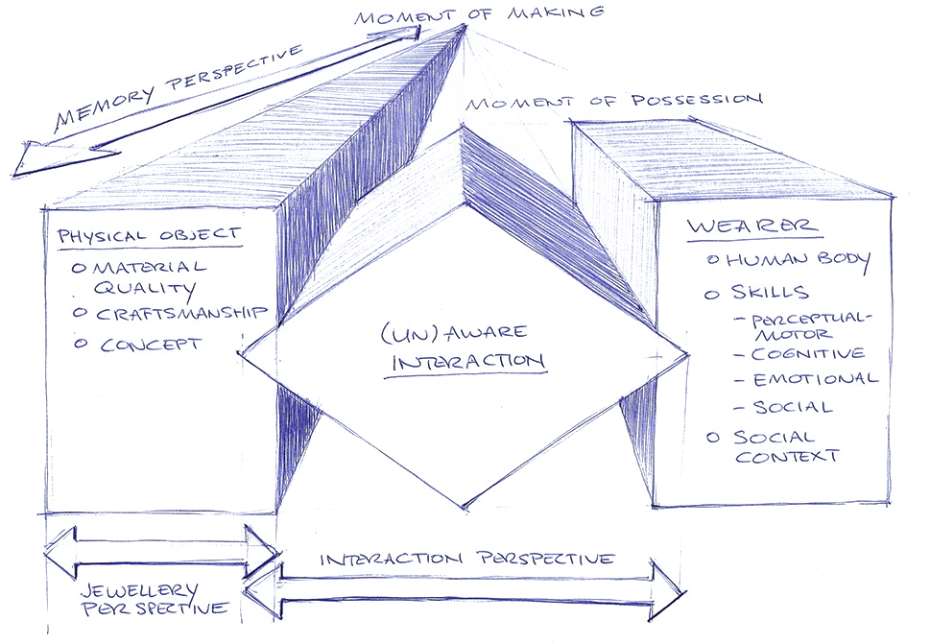
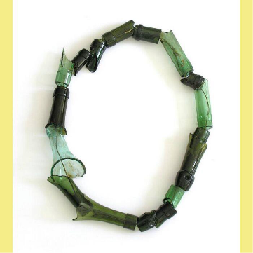
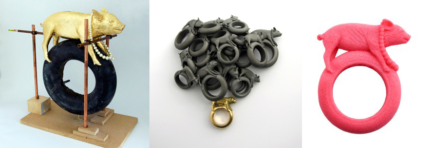
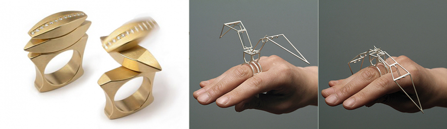
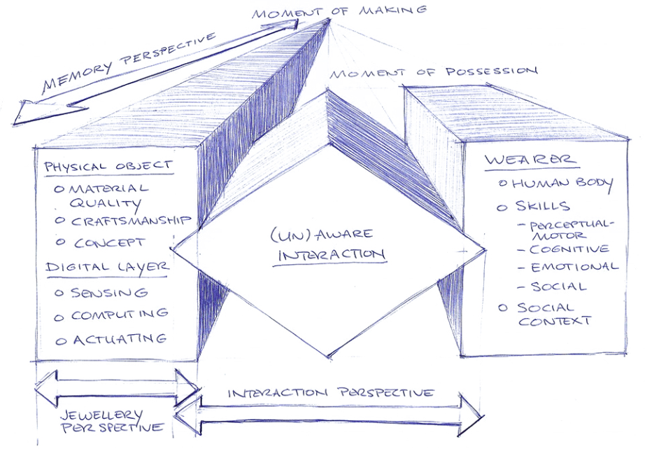
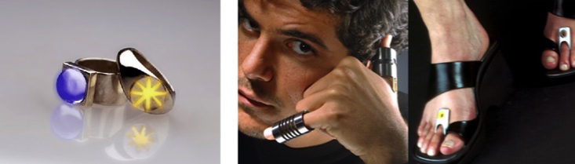
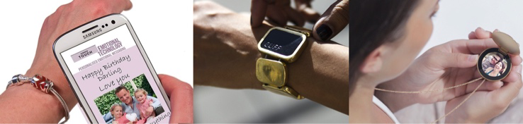
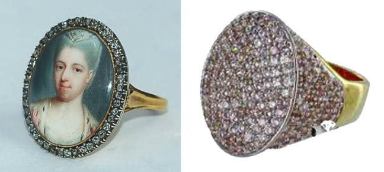
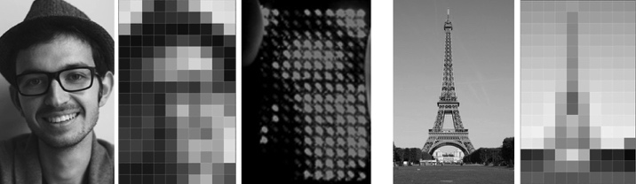
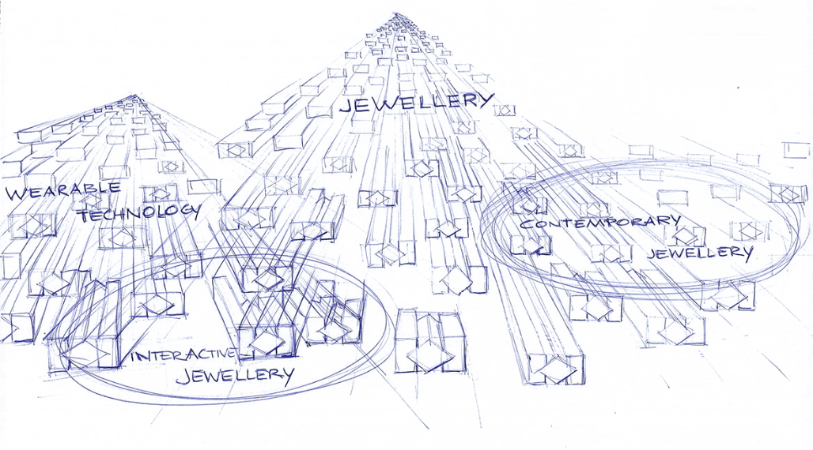

# インタラクティブジュエリー
<!-- pr:block id="title" -->

## ABSTRACT
<!-- pr:block id="s-1ed87848" -->

Many current wearables have a technology-driven background: the focus is primarily on functionality, while their possible personal and social-cultural value is underappreciated. We think that developing wearables from a jewellery perspective can compensate for this. The personal and social cultural values embodied by traditional jewellery are often tightly connected to their function as memento. In this paper we reflect from a jewellery perspective, a memory-studies perspective and a TEI-perspective on three design proposals for interactive jewellery. We identify
<!-- pr:block id="b-b11f9f2e" page="1" status="skipped" -->

1) drawing inspiration from interaction with traditional jewellery,
<!-- pr:block id="b-b11f9f2e-2" page="1" status="skipped" -->

2) using relatively simple technology with high experiential qualities,
<!-- pr:block id="b-b11f9f2e-3" page="1" status="skipped" -->

3) abstract and poetic data representation and
<!-- pr:block id="b-b11f9f2e-4" page="1" status="skipped" -->

4）可能な設計指示として、デジタル宝石にデータを一意に保存します。
<!-- pr:block id="b-b11f9f2e-5" page="1" status="completed" -->

## Author Keywords
<!-- pr:block id="s-1892120e" -->

触覚的な相互作用, インタラクティブなジュエリー, 自伝的記憶, メモ。
<!-- pr:block id="b-8187fc3f" page="1" status="completed" -->

## ACM Classification Keywords
<!-- pr:block id="s-05099469" -->

H.5.m. Information interfaces and presentation (e.g., HCI): Miscellaneous; H.5.2 User interfaces.
<!-- pr:block id="b-53fd37a4" page="1" status="skipped" -->

## 導入
<!-- pr:block id="s-302f9983" -->

<!-- pr:block id="b-4dd74fab" page="1" status="failed" -->
> [!WARNING] 翻訳失敗
> Page 1
>
> Original:
> Over the last decennia electronics rapidly miniaturised while gaining computing power. Devices that used to be static were extended with portable variations: for example the Walkman and the cell phone. More recently electronics have become small enough to be worn directly on the human body integrated in our apparel. Driven by technological possibilities it seems logical to focus on new practical functionalities. However such an approach neglects interesting aspects of clothing and accessory like the implications of the proximity to the human body and its rich material and social connotations. In line with van Dijk et al. [8](#ref-jelle-van-dijk-2013) we see it as ‘our challenge to orchestrate social, human and technological resources’ with an emphasis on human values and practices.

衣服とアクセサリーの分野において,私たちは伝統的に豊かな個人的および社会的文化的価値を体現する宝飾品に特に興味を持っている。 ジュエリーは他者に対して自分の好み,職業,社会的地位を伝えるだけでなく,自分自身に対してもこれらの要素を確認し,自信と帰属感をもたらす。 It appears that memory [25:142–143] and interaction play key roles in these processes. これらの結果から,ウェブブラウザのウェブアプリケーションの開発において,ジュエリー,記憶,インタラクションの観点を考慮することが有益であると考えた。 これにより,伝統的な宝石と同じ価値を持つウェーバブルを開発することを目指す。 これらの装着型装飾品をインタラクティブジュエリーと呼ぶ。 伝統的な宝飾品と同様に,インタラクティブな宝飾は,深い方法で,我々のアイデンティティの形成,確認,表現に寄与する。
<!-- pr:block id="b-b8880058" page="1" status="completed" -->

私たちは、アーティファクトの設計、実現、評価を通じて知識、洞察、仕様が生成される反復的な研究設計プロセスを採用しました[10,30]。 この論文では、次の反復でさらに探求し検証できる設計方向を特定することを目的とした最初の探索的設計反復を提示します。
<!-- pr:block id="b-770290aa" page="1" status="completed" -->

インタラクティブなジュエリーについて何か言う前に、伝統的なジュエリーをよりよく理解する必要があります。 したがって、この論文の残りの部分では、まず伝統的なジュエリーを組み立て、現代のジュエリーがこのフレームワークの境界をどのように探求するかを概説します。 次に、インタラクティブなジュエリーがフレームワークにどのように適合するかを説明し、関連する作業を紹介します。 インタラクティブジュエリーの約束と限界をさらに理解するために、3つのデザイン探索を提示し、フレームワークの文脈でそれらを議論します。 今後の研究の方向性を概説して締めくくります。
<!-- pr:block id="b-c1e9695a" page="1" status="completed" -->

## JEWELLERY
<!-- pr:block id="s-aca66c80" -->

ジュエリーには、並外れた素材で巧みに作られた作品から、実験的なウェアラブルな芸術作品、感情的に帯電した家宝から、衣装にマッチする大量生産されたアクセサリーまで、さまざまなバリエーションがあります。 ジュエリーの定義はバリエーションの数と同じくらいあります（例として[1:11,25:14]を参照してください）。 ほとんどの定義には、少なくとも宝石は人体に身に着けている物理的なオブジェクトであるという概念が含まれています。
<!-- pr:block id="b-e63a21e7" page="2" status="completed" -->

物理的な物体は, 物質の性質, 材料の形状や仕上げの作り手の技術, 物体に物理的に表現された作り手が持つ概念やアイデアからなる物質性を含んでいる。それから人体がある。チェンはまだ着用されていない宝石を「ジュエリー・トゥー・ビー」と呼び,「ジュエリー・トゥ・ビー」という用語は宝石自体が物理的に不完全であることの概念をも含んでいる[4]。宝石は, その所有者による「完成」を待つ空の椅子のように, 着用者を求めている。指を持たない指輪は穴のある物体である」[4:13‐14]。
<!-- pr:block id="b-3d99066b" page="2" status="completed" -->

It is through the interaction with a piece of jewellery that its sensorial qualities become apparent; we pick up a ring in order to assess its weight or move it in the light to see the flickering of a diamond. 人体との長期的な接触は,意識的,無意識的な,個人的,社会的な,宝石との相互作用の豊かなスペクトルをもたらした。 意識的な相互作用はしばしば何らかの儀式に組み込まれ,例えば,ローザンヌの祈り,印章の印章,結婚指輪の交換などである。 また,無意識的な相互作用は,シャワーを浴びる前にネックレスを取り出し,その後再び着用するなど,私たちがほとんど注意を払わない反復的な相対行動である。 日常の儀式の一部となるが、その時点では特別な意味を持たない(ただし、その日の半ばに首飾りを着け直すことを忘れてしまったと気づくと感情的な反応が起こるかもしれない)[1:24]。
<!-- pr:block id="b-9d6d4319" page="2" status="completed" -->

ジュエリーのプライベートな重要性の次に、社会的意味のさまざまな層があります。 この論文では、社会的文脈の存在を認めていますが、着用者とジュエリーとの親密な関係に焦点を当てています。
<!-- pr:block id="b-6f3a2eed" page="2" status="completed" -->

Unger-de Boerは、ジュエリーを研究するための学際的な枠組みを策定しました。 その一環として、彼女はジュエリーを着用する次の動機を定式化しました[25:144–146]：
<!-- pr:block id="b-0de71ad0" page="2" status="completed" -->

• 装飾 人体を装飾する基本的な必要性
<!-- pr:block id="b-38a26961" page="2" status="completed" -->

• 保護: 自分や身近な人を どんな脅威からも守る欲求
<!-- pr:block id="b-38a26961-2" page="2" status="completed" -->

• 繁栄とは 貴重なものを身近に保ちながら 世界に見せることです
<!-- pr:block id="b-38a26961-3" page="2" status="completed" -->

• アイデンティティは 世界に対してアイデンティティーや社会的地位 信念を表現し 自分に対してそれを確認するものです
<!-- pr:block id="b-7b9e4feb" page="2" status="completed" -->

• 記憶 つまり 人生の経緯や親戚を思い出すこと
<!-- pr:block id="b-7b9e4feb-2" page="2" status="completed" -->

1つのデザインでは、動機の組み合わせを見つけることができます。
<!-- pr:block id="b-94bb1dc8" page="2" status="completed" -->

私たちが研究したデザイン提案の大多数（21人中13人）は、主に記念品としてのジュエリーに焦点を当てています。 記憶研究の観点から、記念品は自伝的記憶（AM）への物理的な手がかりです[12](#ref-elise-van-den-hoven-and--2014)。 人生の出来事は自伝的な記憶に保存されている[6]。 記念品は、非常に具体的な記憶や、より広い一連の経験を指すことができます。 他の機能の中でも、AMは自己概念と自己歴史の構築と維持に貢献します。 さらに、記憶は私たちの（不）好き、熱意、信念、偏見を形成する役割を果たします[5](#ref-martin-a-2000)。 通常、メメントジュエリーは（遅い）人、（人生の）イベント、または場所を指します[25:99]。
<!-- pr:block id="b-f2d473e9" page="2" status="completed" -->

<!-- pr:block id="b-d885a481" page="2" status="completed" -->

*Figure 1 宝石の枠組み*
<!-- pr:block id="b-d885a481-caption" -->

ジュエリー、その着用者、およびそれらをつなぐ相互作用の間の関係は静的ではなく、時間の経過とともに発展します。 物理的な物体は傷がつき、そのきらめきが変わります。 私たちの体は変化します：多くの場合、何年も着用した後に外されたジュエリーは、私たちの肉に痕跡を残します。 ジュエリーでそわそわすることは、私たちの毎日の習慣の一部になります。 これらの方法で、ジュエリーは私たちのアイデンティティの一部となり、それなしでは「裸」または「不完全」と感じます（図1）。
<!-- pr:block id="b-868e7434" page="2" status="completed" -->

この段落で紹介されたジュエリー、相互作用、記憶の視点は、この論文の残りの部分で使用され、提示された作品の説明と考察を構成します。
<!-- pr:block id="b-7e7c94f2" page="2" status="completed" -->

## RELATED WORK: CONTEMPORARY JEWELLERY
<!-- pr:block id="s-b65551ec" -->

これらの枠組みは,一般に宝飾品を記述するものである。 宝石を着用しない人でも,宝石は人間の文化の固有の一部であるとして,私的および社会的文化的価値を認識する。 In this first paragraph on related work we’ll focus on the less generally known segment of contemporary jewellery (see Den Besten [1:9–11] for an extensive reflections on possible labels for this segment). 20世紀後半に西ヨーロッパと北米で成長する宝飾家のグループが創造的独立性を主張し,宝飾の一般的な認識に挑戦し始めた[2][16][22]。 At first the approaches differed hugely on both sides of the ocean [1:9], in recent decades contemporary jewellery has become a global scene. 現代宝飾の全体像を示すことは不可能である(詳細は[1,3,23]を参照)。 代わりに,異なる方法で上記の枠組みに挑戦する3つの例を示した。
<!-- pr:block id="b-fd49dd32" page="2" status="completed" -->

45
<!-- pr:block id="b-e8e990a1" page="2" status="skipped" -->

<!-- pr:block id="b-8dcce056" page="3" status="completed" -->

*図2. ベルンハルト・ショビンガーの瓶ネックレス [21] (Figure 2)*
<!-- pr:block id="b-8dcce056-caption" -->

Bernhard SchobingerのFlaschenhalskette（1988）は、スイスのメリデにある高級ホテルのゴミ捨て場で発見された壊れたボトルネックでできています（図2）[21](#ref-bernhard-schobinger-1998)。 この概念的なデザインは、物質的価値だけでなく、着用性や人体との関係についても疑問を投げかけます。
<!-- pr:block id="b-988a58eb" page="3" status="completed" -->

<!-- pr:block id="b-28d93ee7" page="3" status="completed" -->

*Figure 3 夜鳥像(左)と金・チタン製の指輪(中)、ミスピギー(右) 作 テッド・ノーテン [19]*
<!-- pr:block id="b-28d93ee7-caption" -->

テッド・ノートンは、彼の「Haunted by 36 Women」シリーズ（2009年）の一部として、集合彫刻「ナイトバード」を作りました。 これは3Dスキャンされ、デジタル調整され、2つのゴールデンリング、25個のチタンリングの限定シリーズ、およびガラス繊維強化ナイロン製のミスピギーリングの無制限シリーズ[19](#ref-ted-noten-2009)（図3）が作成されました。 金の指輪の小売価格は金の価格と相関しており、彼のウェブサイトでリアルタイムで追跡することができます。 デジタル生産技術と連続生産を使用することで、テッド・ノートンは物質的価値、職人技の価値、特異な存在に疑問を投げかけています。
<!-- pr:block id="b-b48d6738" page="3" status="completed" -->

<!-- pr:block id="b-0ff70ec5" page="3" status="completed" -->

*図4 左から右: マイケル・バーガーのRK-043-1BRとドクノ・ユン作の無題 (Figure 4)*
<!-- pr:block id="b-0ff70ec5-caption" -->

相互作用を更新するという点では、キネティックジュエリーは言及する価値があります。 これらの作品では、人体の運動エネルギーが運動に変換されます。 故フリードリヒ・ベッカーと彼の学者マイケル・バーガーとバーバラ・シュルト・ヘンゲスバッハの設計は、バランスと方位に大きく依存しています。 一方、Dukno Yoonのウェアラブル彫刻は、特定の身体の動きによって作動します（図4）。
<!-- pr:block id="b-c8146390" page="3" status="completed" -->

上記の例は、現代のジュエリーの分野の広さを示しています。 抽象的なレベルでは、行われた声明と提起された質問は、私たち自身の仕事にとって大きなインスピレーションです。 一方、私たちは、メーカー、彼/彼女の概念的なアイデアを強調し、コミュニケーションの手段としてジュエリーに焦点を当てています。 現代のジュエリーは、ギャラリーの文脈で提示されることはめったになく、特定のグループによってのみ着用されるウェアラブルアートの知的な作品です。 この論文では、一般の聴衆が日常的に着用するオブジェクトとの着用者と親密で直感的な相互作用にもっと関心があります。
<!-- pr:block id="b-f5fa81c9" page="3" status="completed" -->

## INTERACTIVE JEWELLERY: RELATED WORK
<!-- pr:block id="s-8dbca99f" -->

ウェアラブル電子機器の出現は、物理的なオブジェクトにデジタルレイヤーを追加する機会を開きました。 デジタルレイヤーを追加するということは、基本的にデータ（センス）を収集し、これらのデータを処理（計算）し、それに基づいて反応する（アクション）可能性を追加することを意味します（図5）。
<!-- pr:block id="b-2efccaff" page="3" status="completed" -->

<!-- pr:block id="b-7107237b" page="3" status="completed" -->

*図5: フレームワークインタラクティブジュエリー (Figure 5)*
<!-- pr:block id="b-7107237b-caption" -->

これは実際にはどのように見えますか？ そして、ジュエリー、相互作用、記憶の視点から、これはどのような意味を持っていますか？ 私たちはこれを探求する最初の人ではありません。この段落の残りの部分では、インタラクティブなジュエリーの分野での関連作業の概要を説明します。 ジュエリーと電子機器の既存の組み合わせを研究するとき、私たちは時間の経過とともに出現した3種類のインタラクティブジュエリーを区別することができます：多国籍企業による探査、個々のデザイナーの仕事、中小企業による商業的試み。
<!-- pr:block id="b-4d8fd90a" page="3" status="completed" -->

21世紀初頭には 多国籍企業が
<!-- pr:block id="b-fedec136" page="3" status="completed" -->

Philips（New Nomadsプロジェクト）[17]、IBM（デジタルジュエリープロジェクト）[18](#ref-cameron-s-2001)、デザインエージェンシーIDEO（Technojewelryプロジェクト）[26]は、ジュエリーとテクノロジーの組み合わせを探求しました（図6）。 結果は、エンジニアリングの背景、問題解決のアプローチ、機能性への焦点、親密さの欠如を示しています[26]。 後者に焦点を当てているため、これらの例は私たちの仕事に直接インスピレーションを与えるものではありません。
<!-- pr:block id="b-26838834" page="3" status="completed" -->

46
<!-- pr:block id="b-707ba189" page="3" status="skipped" -->

<!-- pr:block id="b-04667bdf" page="4" status="completed" -->

*図6 左から右: デジタルジュエリープロジェクトIBM [18], テクノジュエリー計画IDEO [26] (Figure 6)*
<!-- pr:block id="b-04667bdf-caption" -->

第二に、Wallace [27](#ref-jayne-wallace-2007)、Kettley [15]、White & Steel [29](#ref-hazel-white-and-ewan-ste-2015)などの個々のデザイナーやデザイン研究者は、デザインを通じてこの分野を探求しました。 結果は、芸術的価値、個人的な意義への焦点、そして制作プロセスへの献身を示しています[14,26]。
<!-- pr:block id="b-df3c0683" page="4" status="completed" -->

ここで彼らの仕事の完全な概要を提供することは不可能でしょう。 代わりに、この論文の残りの部分で提示する作業の文脈で特に興味深い2つの例を強調します。
<!-- pr:block id="b-904bdc21" page="4" status="completed" -->

ウォレスは4つのデジタルロケットのシリーズを設計しました。それぞれに記憶と忘却に関連する独自の動作があります。記憶を開くたびに異なる画像が表示され、忘れる画像は見れば見るほどゆっくりと劣化します。ダゲールは接続されたカメラで撮影された新しい画像に置き換えることができる1つの画像しか保存しませんが、オルフェウスの画像は2回しか見ることができません[28](#ref-jayne-wallace-2010)。 私たちがスケッチしたフレームワークの観点から、これらのデザインは明らかに記憶の視点を豊かにします。
<!-- pr:block id="b-4bec7aab" page="4" status="completed" -->

ホワイトとスチールは、デジタルレイヤーを物理的なオブジェクトから分離し、参加者がジュエリーによって活性化されたスクリーンベースのアニメーションに関係できるかどうかを探りました。 とりわけ、彼らは、最初は説明できない物理的なジュエリーとの感情的な関係が相互作用によって確立され、インタラクティブなジュエリーは、ジュエリーに関連する暗黙の感情を作る品質を保持し、相互作用を通じて明示することができることを発見しました[29](#ref-hazel-white-and-ewan-ste-2015)。
<!-- pr:block id="b-828da077" page="4" status="completed" -->

<!-- pr:block id="b-3379dac5" page="4" status="completed" -->

*図7 左から右: 吉良[31]、カフ[32]、パープル[33] (Figure 7)*
<!-- pr:block id="b-3379dac5-caption" -->

3)商用インタラクティブジュエリーのコンセプトが市場に導入されている。 携帯電話のメッセージをNFC技術を用いて表示するロケットを開発した[31]。 その他のコンセプトとしては、Cuff(安全ブレスレット)[32](#ref-cuff-2015)やPurple(デジタルロケット)[33](#ref-purple-2015)がクラウドファンディングプラットフォームで紹介され、(Figure 7)が予約可能になった。 これらのカテゴリーは,宝飾品の美学的,社会文化的意味を実用的機能と結びつけて参照するものである。 Due to the fact that the available information is written from a commercial perspective and that they are not yet on the market, it is hard to make an indepth evaluation at this moment in time.
<!-- pr:block id="b-fe58537a" page="4" status="completed" -->

## DESIGNエクスプロレーションズ
<!-- pr:block id="s-9a473a56" -->

工業デザイン（TU/e）の学士号2年生から1年生の修士課程の学生まで、作品の感情的な価値を強調したり、拡大したり、豊かにしたりする方法で、ある種の知性を含むジュエリーをデザインする課題が与えられました。 可能な設計機会の広範な調査を意図していたため、それ以上の制限（ターゲットグループやコンテキストなど）は与えられませんでした。 生徒たちは1学期の間、週に3日この課題に取り組み、目的は作業プロトタイプで仕上げることでした。
<!-- pr:block id="b-3a4a5a5a" page="4" status="completed" -->

デザイン提案の大部分は記念品としてのジュエリーに焦点を当てているため、そのトピックに集中することにしました。 次のパートでは、そのうちの 3 つを個別に説明します。 それぞれのデザイン提案について、私たちは文脈をスケッチし、概念を説明し、相互作用、宝石、記憶の視点からそれを反映します。
<!-- pr:block id="b-62e7711c" page="4" status="completed" -->

## 1. Pix by Laura Claas
<!-- pr:block id="s-671487a1" -->

コンテキスト - 写真はさまざまな理由で撮影されます。 時には、特定の状況を正確に記録したいこともありますが、私たちがしがみつくのは詳細ではなく、雰囲気や経験のような目に見えないものです。 その場合、より高いレベルの詳細が画像の目的から気をそらすと主張することができます。
<!-- pr:block id="b-fb48db31" page="4" status="completed" -->

昔、私たちは写真を撮るときに選択的でした。 デジタル技術の容易さは、写真を撮るための敷居を下げた。 そして通常、私たちは1枚ではなく一連の写真を撮ります。その結果、キュレーションが難しい画像が豊富になります。
<!-- pr:block id="b-fa75f2fa" page="4" status="completed" -->

<!-- pr:block id="b-18646c0d" page="4" status="failed" -->
> [!WARNING] 翻訳失敗
> Page 4
>
> Original:
> Figure 8

*Figure 8. Pix by Laura Claas*
<!-- pr:block id="b-18646c0d-caption" -->

コンセプト - ピクス（図8）は、着用者がリングに低解像度の画像として表示される写真を撮ることができるリングです。 解像度が低いため、無関係な詳細がぼやけるだけでなく、画像も描かれているものを知っている人だけが読めるようになります。 カメラはリングの手のひら側に配置されています。 写真を撮るには、片方がカメラを向け、もう片方の手でリングの両側を押します。 そうするための体勢は、リングを賞賛するために使用されたものを思い出させます。 リングから写真をダウンロードすることはできません。新しい写真を撮ることは、前の写真を上書きすることを意味します。
<!-- pr:block id="b-d0adea56" page="4" status="completed" -->

47
<!-- pr:block id="b-959ec125" page="4" status="skipped" -->

反射は, 相互作用の観点から,「指輪を一日中着用する」と「写真を作る」の間に区別できる。前者は従来の指輪の着用とほとんど変わらないが、後者はより詳細な観察が必要である。また, 写真を撮影する際に必要な体位は, 伝統的な宝石との相互作用に似ているので, 親しみやすいと感じる。これは, 実際に写真を撮影する方法によって妥協され, 古典的なプッシュボタン相互作用を思い起こさせる。宝石の比喩では, むしろ擦りや研磨のような動作を期待する。また, カメラを動かすとダイナミックプレビュー(ビューファインダ)が追加され, さらにインタラクションが豊かになった。これはイメージをよりコントロールできるだけでなく、指輪を見ているときに光の中で輝く宝石を見るために動くという宝石の比喩にも合う。
<!-- pr:block id="b-41f5cedf" page="5" status="completed" -->

<!-- pr:block id="b-352d1c8c" page="5" status="completed" -->

*Figure 9左からAnonymous小型ポルタイトリング18世紀[34]、Anonymousパヴェリング*
<!-- pr:block id="b-352d1c8c-caption" -->

<!-- pr:block id="b-63f58c8e" page="5" status="failed" -->
> [!WARNING] 翻訳失敗
> Page 5
>
> Original:
> From a jewellery-perspective Pix reminds of classical miniature portrait rings and pavé-rings in which the gemstones are replaced by SMD-leds (Figure 9). In terms of the previously mentioned motivations to wear jewellery [25:144–146] Pix is next to a memento, also a way to express identity. On an abstract level, the limited readability of Pix can be associated with the concept of social inclusion and exclusion that is often seen in jewellery: jewellery as a sign that can only be read by a limited group of insiders [1:24]. Pix is only readable for those who were present when the picture was taken. The shared understanding might strengthen their mutual bond. In a technical iteration on Pix Xander Meijering explored the readability of a 10x16 SMD-LEDmatrix (Figure 10).

<!-- pr:block id="b-c6f9276b" page="5" status="completed" -->

*図10 ピクセル化画像の読み取り性を持つ技術的探索, 左から右: 画像, コンピュータ生成ピクセリ化画像,10x16SMD‐LEDマトリックス上の画像, 画像, 計算機生成画像。 (Figure 10)*
<!-- pr:block id="b-c6f9276b-caption" -->

写真を撮るという意識的な行動を通じて、Pixは将来の記憶のための手がかりを作ります。 リングは、メモリのはるかに豊かなコンテンツに関連する抽象的な視覚記憶キュー（ピクセル化された画像）のキャリアです。 キューの抽象的な性質のため、着用者が保持したい実際の記憶は、雰囲気や感情のような目に見えないものである可能性があります。 だから、例えばエッフェル塔のイメージは、オブジェクトに関するものではなく、そこで受け取った提案とそれが呼び起こしたロマンチックな感情に関するものです。
<!-- pr:block id="b-0f42c105" page="5" status="completed" -->

<!-- pr:block id="b-e3e0eb1c" page="5" status="failed" -->
> [!WARNING] 翻訳失敗
> Page 5
>
> Original:
> Figure 11

*Figure 11. Memento by Karin Niemantsverdriet*
<!-- pr:block id="b-e3e0eb1c-caption" -->

## 2. Memento by Karin Niemantsverdriet
<!-- pr:block id="s-e9e68418" -->

コンテキスト - ほとんどの記憶は写真に収めることができますが、場合によっては聴覚記録の方がはるかに適しています。 例えば、その声は人間のアイデンティティのユニークな部分ですが、彼または彼女が過ぎ去った後の声の音を思い出すのは難しいです。 または、結婚式のスピーチは後で読み返すことができますが、録音はスピーカーのレトリックと聴衆の反応が含まれているため、はるかに豊かです。
<!-- pr:block id="b-41d6ae14" page="5" status="completed" -->

<!-- pr:block id="b-5dc2878f" page="5" status="failed" -->
> [!WARNING] 翻訳失敗
> Page 5
>
> Original:
> Concept – Memento (Figure 11) is a sound-locket that aims to capture this type of events. In contrast to traditional lockets that contain pictures, this one contains sound. It can be opened on two sides. By opening the one side it starts recording. When the other side is opened play back starts. The volume is such that the locket needs to be held close to the ear during play back. In order to navigate through the samples one pulls the chain. The more often a fragment is listened to, the easier it can be found. Samples that are hardly listened to will diminish and ultimately disappear from the lockets memory. Samples are uniquely stored on the locket: it’s impossible to download samples from the locket.

リフレクション - 録音するためにロケットを世界に向けて開き、再生中に耳に近づける相互作用は、録音中の世界との外向的な関与と、聞き返すというより内省的で親密な行為をうまく反映しています。 Mementoのサンプルを閲覧する相互作用は、ペンダントで無意識のうちにそわそわすることに触発されています。 しかしながら
<!-- pr:block id="b-45813ad3" page="5" status="completed" -->

1) the interaction is reversed: the chain is pulled through the locket, instead of moving the pendant over the chain. And
<!-- pr:block id="b-45813ad3-2" page="5" status="skipped" -->

2）無意識の相互作用（ペンダントで遊ぶ）は、意識的な相互作用（サウンドサンプルをナビゲートする）に変わります。 Hornecker [11](#ref-eva-hornecker-2012) は、慣れ親しんだインタラクション シナリオ (従来のジュエリーなど) をコンピュータで拡張された状況にシームレスに転送できると想定するときは、注意する必要があると主張しています。 これには、次の反復でユーザーとのテストが必要です。
<!-- pr:block id="b-45813ad3-3" page="5" status="completed" -->

48
<!-- pr:block id="b-99f1af75" page="5" status="skipped" -->

宝石の視点から、イメージを含むロケットの比喩は明らかです。 最大の違いは、従来のロケットには物理的に写真が含まれているのに対し、音は明らかに重要ではないということです。
<!-- pr:block id="b-03ff06c3" page="6" status="completed" -->

Mementoを使用すると、着用者は聴覚記憶の手がかりを意識的に記録して再生することができます。 ロケットはキャリアであり、音は記憶キューの媒体です。 キューは、より広い記憶（例えば、その人の記憶への入り口としての誰かの声の音）を引き起こすか、それ自体が記憶（例えば、ストリートミュージシャンバージョンのLet it beの並外れた美しさ）を引き起こすことができます。
<!-- pr:block id="b-941321db" page="6" status="completed" -->

<!-- pr:block id="b-9d79e1e1" page="6" status="failed" -->
> [!WARNING] 翻訳失敗
> Page 6
>
> Original:
> Figure 12

*Figure 12. Leth by Luke Noothout.*
<!-- pr:block id="b-9d79e1e1-caption" -->

## 3. Leth by Luke Noothout
<!-- pr:block id="s-158b9378" -->

コンテキスト - このデジタル時代には、祖父母が一生撮った写真よりも、1回の休暇旅行で多くの写真を撮ります。 これらのファイルのキュレーションはほとんど不可能であるため、取得が複雑になります。 その結果、私たちのハードドライブは、私たちがもう見ることのないファイルでいっぱいになりますが、それは感情的な意味を持っています。
<!-- pr:block id="b-76b88e30" page="6" status="completed" -->

<!-- pr:block id="b-f0b74591" page="6" status="failed" -->
> [!WARNING] 翻訳失敗
> Page 6
>
> Original:
> Concept – Leth (Figure 12) is a radical concept that proposes to accept the useless abundance of digital files, without neglecting their emotional significance. It is a hard drive that can be worn as a pendant. When storing data on Leth the files are consciously corrupted and become unreadable. The only trace a file leaves in the digital world is a dot on the milky-way-like interface of the uploading software on the computer. This way the meaning of the digital files is supposed to be passed on to the physical object, which becomes an abstract container of cherished memories. In order to hold on to an individual memory one scratches Leth’s casing with the accompanying tool and documents both the position of the scratch and the content of the memory in the booklet.

リフレクション - レスは、コンピューターに接続し、画面を介して対話する必要がある唯一の設計提案です (古典的な HCI)。 Lethにデータを保存することは、その後ファイルにアクセスできなくなるため、非常に意識的なアクションである必要があります。
<!-- pr:block id="b-fa5b652f" page="6" status="completed" -->

ジュエリーの視点から見ると、カバーを意識的に引っ掻くと、ジュエリーが着用することで成長する緑青が思い出されます。 最初の傷は損傷のように感じるかもしれませんが、しばらくすると、その使用の痕跡は作品の本質的な部分になります。表面はユニークな物理的歴史を語っています。 第二に、手の届かないが貴重なコンテンツを保持している宝石の例がいくつかあります。 例えば、故人の遺灰を保持する記念のペンダント。
<!-- pr:block id="b-d753999d" page="6" status="completed" -->

この場合、ペンダントはキャリアであり、メモリキューの媒体でもあります。 Lethは一連の大切な出来事を体現しており、ConwayとPleydell-Pearce [5](#ref-martin-a-2000)が「生涯の期間」と呼ぶものを指します。 付属の小冊子のメモは、イタリアへの休暇旅行など、「一般的なイベント」を手がかりにすることができます。 Lethは、その休日に飲んだワインなど、イベント固有の知識をキューするのにはあまり適していません。 記念品であることの次に、Lethはデジタルアイデンティティを保護するセーフガードです。
<!-- pr:block id="b-fc10fd4d" page="6" status="completed" -->

## DISCUSSION
<!-- pr:block id="s-f1f6256f" -->

前の段落では、3つの概念を説明し、それらを個別に検討しました。 この段落では、ジュエリーにデジタルコンポーネントを追加することの約束と制限について考察します。 この考察では、ジュエリー、相互作用、記憶の視点を統合します。
<!-- pr:block id="b-32acbb5e" page="6" status="completed" -->

<!-- pr:block id="b-cc08a812" page="6" status="completed" -->

*Figure 13: 着用技術とジュエリーの交差点におけるインタラクティブジュエリーが生まれる*
<!-- pr:block id="b-cc08a812-caption" -->

デザイン提案は、伝統的なジュエリーとの相互作用がインタラクティブなジュエリーにマッピングされるさまざまな方法を示しています。 このことから、私たちはジュエリーに関する私たちの集合的な記憶の重要性を理解しました。それは、ジュエリーに関する私たちの個々の歴史で構成されています。 この視点では、ウェアラブル技術とジュエリーの歴史が一緒になるインタラクティブなジュエリーが出現します。 インタラクティブなジュエリーは、現代のジュエリーが独自の方法で行うのと同じように、ジュエリーの理解を広げます（図13）。
<!-- pr:block id="b-cda7e8f5" page="6" status="completed" -->

理論的には,デジタル技術の付加により,ジュエリーは着用者の入力に対してダイナミックに反応できるという意味でアクティブになる。 PixとLethは,データがオブジェクトに保存されるときに符号化され,その後新しいデータが追加されるまで静的に残る。 音声の記憶を行うためのメメントは,音声の録音後に音声の断片とのインタラクションを可能にする。 しかし,ほとんど聴かれていない断片は,再生回数が多いほど検索が難しくなる。 It is as if the piece wants to say ‘no need to hurry, the two of us have plenty of time ahead’; a totally different take on technology then the instantaneous reaction and availability that we are used to.
<!-- pr:block id="b-76321741" page="6" status="completed" -->

49
<!-- pr:block id="b-878cfe91" page="6" status="skipped" -->

興味深いことに,符号化によってデータは読みやすくなる(Pix)か読みにくくなる(Leth)こともある。 この方法は,データを収集し,より詳細にユーザに返す機能的ウェアラブルの動向に反している。 これらの設計決定はどのように解釈できるのか。 記憶研究の観点から,記憶のキューはかなり具体的なものからかなり抽象的なものまで変化することが知られている。 More abstractly represented data are more likely to facilitate reflection [13](#ref-elise-van-den-hoven-2012). さらに,Gaverらは,情報の曖昧さが対話型システム[9](#ref-william-gaver-2003)との密接な個人的関わりを促進すると主張した。 宝石の観点から,読みやすさは,包含と排除の概念と関連している[1:24]。 これはPixの場合に適用できるが,Lethでは適用できない。 ユーザ体験の観点から,低解像度画像(Pix)を使用することは,初期のデジタル時代のピクセル化された文字のノスタルジックな記憶を呼び起こすと論じられる。 デジタルゲームの分野では,初期のデジタル・ゲームの視覚的品質に対する関心が再び高まり,オリジナルの両ゲームが市場に再導入され,新しいゲームは初期の前身の[24](#ref-melanie-swalwell-2007)からインスピレーションを得ている。 It seems not unlikely that this so-called Technostalgia could finds its way to other disciplines that are not primarily concerned with practical functionality.
<!-- pr:block id="b-347a35ce" page="7" status="completed" -->

3つの概念はすべて、データの同期、共有、乗算を意識的に破棄します。 自動バックアップとクラウドストレージの時代では、データはハードウェアから独立しています。 Pix、Memento、Lethは、データを宝石に一意に保存することでこれに対抗しているようです。これにより、デジタルと物理的なハイブリッドのようなものを作成します。ハードとソフトウェアは分離できません。 例えば、Ted Notenによる関連作品の文脈では、デザイン提案が固有の個人的なコンテンツに基づいて一般的なオブジェクトを特異なオブジェクトに変えるように見えることは興味深い考えです（[1:26–32]も参照してください）。
<!-- pr:block id="b-2a8448d3" page="7" status="completed" -->

ペトレリとウィテカー[20](#ref-daniela-petrelli-and-ste-2010)は、一般的に話されている物理的な記念品とデジタルの記念品の認識が異なることを発見しました。 物理的な記念品は多面的であると考えられていますが、デジタル記念品は不安定で、単純で非人間的すぎると見なされます。
<!-- pr:block id="b-b495927e" page="7" status="completed" -->

以上から、動的な動作、データの視覚化、データ共有に関しては、どちらの設計提案も最先端の技術を使用していないと結論付けることができます。 これにより、次世代技術の導入により、早期廃棄が妨げられる可能性があります。
<!-- pr:block id="b-3b76f8cb" page="7" status="completed" -->

If we take a closer look at the design proposals as memento we see that the digital layer introduces new modalities (e.g. sound) to cue autobiographical memory. 文献から知られているのは,視覚メディア(特に写真)が[12](#ref-elise-van-den-hoven-and--2014)を記憶するための最もよく使われる手がかりである。 Dibらは,聴覚的な情報は視覚的なものよりも個人的でプライベートなものとして認識されることを示した[7](#ref-lina-dib-2010)。 これはメメントの親密な性格に合致する。
<!-- pr:block id="b-fb363fe6" page="7" status="completed" -->

## CONCLUSION AND FUTURE PERSPECTIVE
<!-- pr:block id="s-2d93cba4" -->

記念品としてのインタラクティブジュエリーのデザイン探索を行った。これは, 自伝的記憶のための手掛かりの創造だけでなく, 集団記憶に対する手がかりを創造するための探索であった。人間は伝統的な宝飾品に関して, 宝飾品の社会文化的意味だけでなく, 豊かな集団記憶を持っている。また, ジュエリーに関連した相互作用シナリオ, 姿勢, 動作も含めた。これらの集合的記憶を, インタラクティブジュエリーのデザインにおいて, 技術的に駆動されたガジェットとして認識される代わりに, 本当のジュエリーとして解釈されるように, 引き起こすことを目指した。また, この目標を達成するための設計方向を示した。
<!-- pr:block id="b-3af63d4c" page="7" status="completed" -->

• 伝統的な宝石との相互作用を インタラクティブな宝石に変換するのです。
<!-- pr:block id="b-d7593537" page="7" status="completed" -->

<!-- pr:block id="b-d7593537-2" page="7" status="failed" -->
> [!WARNING] 翻訳失敗
> Page 7
>
> Original:
> • using relatively simple technology with high experiential qualities, instead of using state-of-the-art technology

• 抽象的で詩的なデータ表現を 具体的で詳細な情報と対比させる
<!-- pr:block id="b-d7593537-3" page="7" status="completed" -->

• data uniquely stored on the jewel.
<!-- pr:block id="b-d7593537-4" page="7" status="skipped" -->

設計方向のこれらの妥当性を評価するには、さらなる研究が必要です。 次の反復では、現実世界での縦断テストを可能にする、より詳細で堅牢なプロトタイプを実現することを目指しています。 それは世界、人体にあり、ジュエリーはインタラクティブであろうとなかれ、その多くの品質を示しています。
<!-- pr:block id="b-0487fa67" page="7" status="completed" -->

## 感謝
<!-- pr:block id="s-52918494" -->

この研究は、オランダ科学研究機関（NWO）のSTW VIDI助成金番号016.128.303によって支援され、Elise van den Hovenに授与されました。
<!-- pr:block id="b-a8ea4422" page="7" status="completed" -->

デザインコンセプトに関わったすべての人、特に学生とその監督者に感謝します。
<!-- pr:block id="b-d86a5277" page="7" status="completed" -->

## REFERENCES
<!-- pr:block id="s-034931db" -->

1. Liesbeth den Besten. 2011. On jewellery: A compendium of international contemporary art jewellery. Arnoldsche.
<!-- pr:block id="b-58d0d890" page="7" status="skipped" -->

2. Liesbeth den Besten. 2013. Europe. In Contemporary Jewelry in Perspective, Damian Skinner (ed.). Lark Jewelry & Beading, New York, 99–114.
<!-- pr:block id="b-e3e47ed1" page="7" status="skipped" -->

3. Lin Cheung, Beccy Clarke, and Indigo Clarke (eds.). 2006. New Directions in Jewellery II. Black Dog Publishing, London.
<!-- pr:block id="b-235e18b9" page="7" status="skipped" -->

4. Lin Cheung. 2006. Wear, wearing, worn: the transitions of jewels to jewellery. In New Directions in Jewellery II, Lin Cheung, Beccy Clarke and Indigo Clarke (eds.). Black Dog Publishing, 12–23.
<!-- pr:block id="b-ef974114" page="7" status="skipped" -->

5. Martin A. Conway and Christopher W. PleydellPearce. 2000. The construction of autobiographical memories in the self-memory system. Psychological Review 107, 2: 261–288. http://doi.org/10.1037//0033-295X.107.2.261
<!-- pr:block id="b-f47e88d5" page="7" status="skipped" -->

50
<!-- pr:block id="b-dafdd612" page="7" status="skipped" -->

6. Martin A. Conway and David C. Rubin. 1993. The structure of autobiographical memory. In Theories of Memory, A. Collins, S. Gathercole, Martin A. Conway and P.E. Morris (eds.). Lawrence, 103–137.
<!-- pr:block id="b-08a170ce" page="8" status="skipped" -->

7. Lina Dib, Daniela Petrelli, and Steve Whittaker. 2010. Sonic souvenirs: exploring the paradoxes of recorded sound for family remembering. Proceedings of the 2010 ACM conference on Computer supported cooperative work: 391–400. http://doi.org/http://doi.acm.org/10.1145/1718918.1718
<!-- pr:block id="b-300841b5" page="8" status="skipped" -->

8. Jelle van Dijk, Camille Moussette, Stoffel Kuenen, and Caroline Hummels. 2013. Radical clashes. Proceedings of the 7th International Conference on Tangible, Embedded and Embodied Interaction - TEI ’13, November 2015: 323. http://doi.org/10.1145/2460625.2460680
<!-- pr:block id="b-cd32bdb1" page="8" status="skipped" -->

9. William Gaver, Jacob Beaver, and Steve Benford. 2003. Ambiguity as a resource for design. Chi 2005, 5: 233–240. http://doi.org/10.1145/642611.642653
<!-- pr:block id="b-b35728da" page="8" status="skipped" -->

10. Conny Golsteijn, Elise van den Hoven, David Frohlich, and Abigail Sellen. Reflections on Craft Research For and Through Design. Retrieved October 26, 2015 from http://delivery.acm.org.dianus.libr.tue.nl/10.1145/2640 000/2639194/p421 golsteijn.pdf?ip=131.155.2.68&id=2639194&acc=AC TIVE SERVICE&key=0C390721DC3021FF.ECCBF8AC29 DF345E.4D4702B0C3E38B35.4D4702B0C3E38B35& CFID=556020003&CFTOKEN=28091657&__acm__= 14458
<!-- pr:block id="b-e4ded5a8" page="8" status="skipped" -->

11. Eva Hornecker. 2012. Beyond Affordance: Tangibles ’ Hybrid Nature. Tei: 175–182. http://doi.org/10.1145/2148131.2148168
<!-- pr:block id="b-12445509" page="8" status="skipped" -->

12. Elise van den Hoven and Berry Eggen. 2014. The Cue Is Key. Zeitschrift für Psychologie 222, 2: 110–117. http://doi.org/10.1027/2151-2604/a000172
<!-- pr:block id="b-1b9df9ab" page="8" status="skipped" -->

13. Elise van den Hoven, Corina Sas, and Steve Whittaker. 2012. Introduction to this special issue on designing for personal memories: past, present, and future. Human– Computer Interaction 27, May 2014: 1–12. http://doi.org/10.1080/07370024.2012.673451
<!-- pr:block id="b-cb4350e5" page="8" status="skipped" -->

14. Sarah Kettley. 2008. Peacocks and wallflowers: (in)visibility with digital jewellery. Visual Communication 7, 3: 303–315. http://doi.org/10.1177/1470357208092321
<!-- pr:block id="b-ca10f302" page="8" status="skipped" -->

15. Sarah Kettley. 2007. Crafting the wearable computer. Computing.
<!-- pr:block id="b-38bd4e41" page="8" status="skipped" -->

16. Kelly Hayes L’Ecuyer. 2013. North America. In Contemporary Jewelry in Perspective, Damian Skinner (ed.). Lark Jewelry & Beading, New York, 115–130.
<!-- pr:block id="b-7683482f" page="8" status="skipped" -->

51
<!-- pr:block id="b-36091e72" page="8" status="skipped" -->

17. Stefano Marzano, Josephine Green, and Clive van Heerden. 2000. New Nomads: an exploration of wearable electronics by Philips. 010 Publishers.
<!-- pr:block id="b-36c0f245" page="8" status="skipped" -->

18. Cameron S. Miner, Denise M. Chan, and Christopher Campbell. 2001. Digital jewelry: wearable technology for everyday life. Extended Abstracts on Human Factors in Computing Systems: 45–46. http://doi.org/10.1145/634067.634098
<!-- pr:block id="b-d27b2f39" page="8" status="skipped" -->

19. Ted Noten. 2009. Haunted by 36 Women, Night Bird, Miss Piggy. Retrieved November 7, 2015 from http://www.tednoten.com/work/portfolio/haunted-by-36-women
<!-- pr:block id="b-de52523a" page="8" status="skipped" -->

20. Daniela Petrelli and Steve Whittaker. 2010. Family memories in the home: Contrasting physical and digital mementos. Personal and Ubiquitous Computing 14, 2: 153–169. http://doi.org/10.1007/s00779-009-0279-7
<!-- pr:block id="b-7822e9a4" page="8" status="skipped" -->

21. Bernhard Schobinger. 1998. Flaschenhalskette. Online Catalogue Stedelijk Museum Den Bosch. Retrieved November 7, 2015 from http://www.sm-s.nl/collections
<!-- pr:block id="b-f681c5fa" page="8" status="skipped" -->

22. Damian Skinner. 2013. The history of Contemporary Jewelry. In Contemporary Jewelry in Perspective, Damian Skinner (ed.). Lark Jewelry & Beading, New York, 83–85.
<!-- pr:block id="b-14928e19" page="8" status="skipped" -->

23. Damian Skinner (ed.). 2013. Contemporary Jewelry in Perspective. Lark Jewelry & Beading, New York.
<!-- pr:block id="b-ea6c2e55" page="8" status="skipped" -->

24. Melanie Swalwell. 2007. The Remembering and the Forgetting of Early Digital Games: From Novelty to Detritus and Back Again. Journal of Visual Culture 6, 2: 255–273.
<!-- pr:block id="b-139a48ce" page="8" status="skipped" -->

25. Marianne Unger-de Boer. 2010. Sieraad in context: Een multidisciplinair kader voor de beschouwing van het sieraad [Jewellery in context: a mulitidisciplinary framework to study jewellery].
<!-- pr:block id="b-7f65f6e2" page="8" status="skipped" -->

26. Jayne Wallace and Andy Dearden. 2005. Existing approaches to digital jewellery. In Future Interaction Design, H. Isomaki, C. Roast and P. Saariluoma (eds.). springer, London.
<!-- pr:block id="b-c92980c7" page="8" status="skipped" -->

27. Jayne Wallace. 2007. Emotionally charged: A practicecentred enquiry of digital jewellery and personal emotional significance. Development, July: 1–228. http://doi.org/10.1258/jrsm.100.8.368
<!-- pr:block id="b-215bfa46" page="8" status="skipped" -->

28. Jayne Wallace. 2010. Unpicking the Digital. Retrieved November 2, 2015 from http://nrl.northumbria.ac.uk/12106/
<!-- pr:block id="b-63cb0bac" page="8" status="skipped" -->

29. Hazel White and Ewan Steel. Agents of change: from collection to connection. Retrieved November 2, 2015 from http://www.tandfonline.com.dianus.libr.tue.nl/doi/pdf/1 0.2752/146069207789272703
<!-- pr:block id="b-41136230" page="8" status="skipped" -->

30. John Zimmerman, Jodi Forlizzi, and Shelley Evenson.
<!-- pr:block id="b-5553e6ca" page="8" status="skipped" -->

Share, Show And Tell TEI 2016, February 14-17, 2016, Eindhoven, the Netherlands
<!-- pr:block id="b-fbe03cf1" page="9" status="skipped" -->

2007. Research Through Design as a Method for Interaction Design Research in HCI.
<!-- pr:block id="b-9b5e21c9" page="9" status="skipped" -->

31. Kiroco. Retrieved August 1, 2015 from
<!-- pr:block id="b-9d56d7e4" page="9" status="skipped" -->

32. Cuff. Retrieved August 1, 2015 from https://cuff.io
<!-- pr:block id="b-de4ce8d6" page="9" status="skipped" -->

33. Purple. Retrieved August 1, 2015 from https://www.artefactgroup.com/content/work/purple-awearable-locket-for-the-21st-century/
<!-- pr:block id="b-3ed4bd06" page="9" status="skipped" -->

34. Miniature Portrait Ring. Retrieved August 1, 2015 from http://www.rowanandrowan.com/Articles/382253/Row an_and_Rowan/Rings/Rings_ITEMS/ny7_portrait_min iature.aspx
<!-- pr:block id="b-26bbf8c1" page="9" status="skipped" -->

52
<!-- pr:block id="b-6d47b666" page="9" status="skipped" -->
