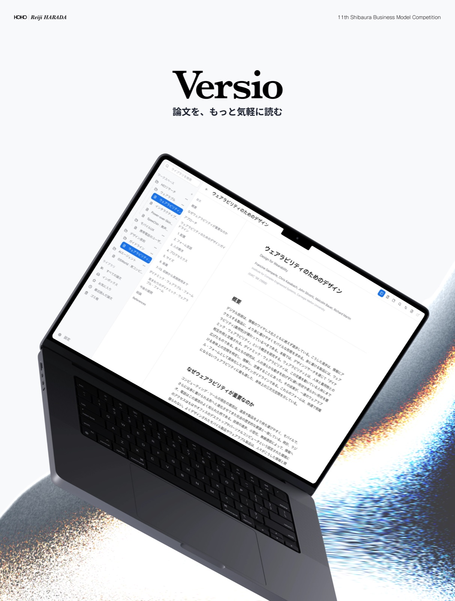

<p align="center">
  
</p>

<h1 align="center">Versio</h1>

<p align="center">
  <b>論文を、もっと気軽に読む。</b><br>
  英語論文の PDF を、読みやすい日本語の 1 カラムに再構成するローカル動作の macOS アプリ
</p>

<p align="center">
  
  
  
</p>

---

## Versio とは

論文は見つけやすくなりましたが、固定レイアウトの PDF は小さな画面では読みにくく、翻訳・メモ・文献整理のために複数のツールを行き来する負担が残っています。

Versio は、誌面の見た目を複製するのではなく、タイトル・見出し・段落・図表・参考文献といった**意味構造を保ったまま**、画面幅に合う 1 カラムへ再構成します。

**取り込む → 読みやすく変換 → 読む・訳す → メモを残す → 持ち歩く** までを、ひとつのアプリで完結させます。

- **ローカル完結** — 翻訳は端末内の MADLAD-400 3B（MPS / bfloat16）で実行し、外部 API を必須にしません
- **誤読を防ぐ設計** — 翻訳後に数値・引用・否定表現などの不整合を点検し、問題があれば警告や原文表示に切り替えます
- **スマホでも読める** — 論文を EPUB に変換して持ち歩けます。実在する論文 PDF 1,432 本で変換を試し、1,423 本（99.4%）で成功しました

> 抽出・翻訳の精度は現在も改善中です。最新の状態は [CURRENT_STATE.md](./CURRENT_STATE.md) を参照してください。

## 主な機能

| | |
| --- | --- |
| **ライブラリ** | PDF の取り込み、階層フォルダ、インボックス / お気に入り / 最近読んだ論文、⌘K 検索 |
| **リーダー** | 日本語 1 カラム本文、目次、原文の段落展開、読書位置の保存、論文内検索（⌘F） |
| **メモと用語** | 訳文上のインラインメモ、用語集の参照・編集 |
| **図表** | 本文内表示と拡大表示 |
| **書き出し** | 訳文 Markdown / Notion 用 ZIP / EPUB（「スマホで読む」で同期先へ送信）、フォルダ単位の一括 ZIP |
| **元 PDF** | いま読んでいる付近のページを元 PDF で開く |

## 対応環境

- macOS（Apple Silicon。翻訳は MPS を前提）
- Tauri 2 デスクトップアプリ（推奨）。ブラウザ UI のみの開発モードも利用可（OCR なし）
- Windows / クラウド同期 / 常設 AI チャットは現時点では対象外です（[ROADMAP.md](./ROADMAP.md)）

## はじめかた

```bash
npm install

# 推奨: Tauri 開発アプリ（翻訳サーバーはアプリが起動）
npm run tauri:dev

# ブラウザ UI のみ
./restart-translation-server.sh   # 別ターミナル
npm run dev                       # http://localhost:5173
```

```bash
# 日常確認用 .app（cached Python、dmg なし）
npm run tauri:build:fast

# リリース確認（clean Python + .app + .dmg）
npm run tauri:build:clean
open "src-tauri/target/release/bundle/macos/Versio.app"
```

Python 環境の準備やトラブルシュートは [QUICKSTART.md](./QUICKSTART.md)、ビルド時間の目安は [docs/BUILD_TIMINGS.md](./docs/BUILD_TIMINGS.md) にあります。

```bash
npm test
npm run lint
npm run verify:browser   # Playwright（dev / preview 起動後）
```

## ロードマップ

個人向けの機能は無料・オープンソースで公開しています。今後は、読んだ論文・注釈・コメントを研究室に蓄積し、先輩の知見を後輩へ引き継げる**研究室向けの共有機能**の開発を予定しています。詳細は [ROADMAP.md](./ROADMAP.md) を参照してください。

## ドキュメント

| 文書 | 内容 |
| --- | --- |
| [CURRENT_STATE.md](./CURRENT_STATE.md) | いまの実装の状態（機能・制限・検証） |
| [ROADMAP.md](./ROADMAP.md) | これから達成するプロダクト目標 |
| [QUICKSTART.md](./QUICKSTART.md) | 起動・環境・トラブルシュート |
| [UI_INTERACTION_PRINCIPLES.md](./UI_INTERACTION_PRINCIPLES.md) | UI の設計原則 |
| [DATA_ARCHITECTURE.md](./DATA_ARCHITECTURE.md) | Paper Package / SQLite |
| [ACADEMIC_PDF_EXTRACTION_ARCHITECTURE.md](./ACADEMIC_PDF_EXTRACTION_ARCHITECTURE.md) | PDF 抽出のアーキテクチャ |
| [TRANSLATION_CORPUS_AUDIT.md](./TRANSLATION_CORPUS_AUDIT.md) | 翻訳品質の監査 |
| [P0_HARDENING.md](./P0_HARDENING.md) | セキュリティ・起動・再現ビルド |
| [docs/](./docs/) | ベンチマーク・評価・リリース手順など |
| [docs/research/](./docs/research/) | 翻訳モデルの評価・実験ノート |
| [AGENTS.md](./AGENTS.md) | コーディングエージェント向けの実装制約 |

## ライセンス

[MIT License](./LICENSE) © 2026 Reiji HARADA（HOHO）

利用しているサードパーティのソフトウェア・モデルについては [THIRD_PARTY_NOTICES.md](./THIRD_PARTY_NOTICES.md) を参照してください。

---

<p align="center"><sub>第 11 回 芝浦ビジネスモデルコンペティション（SBMC）応募作品</sub></p>
