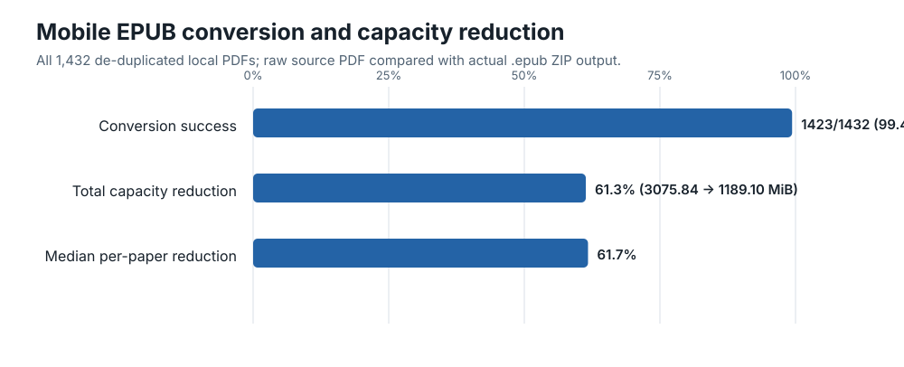
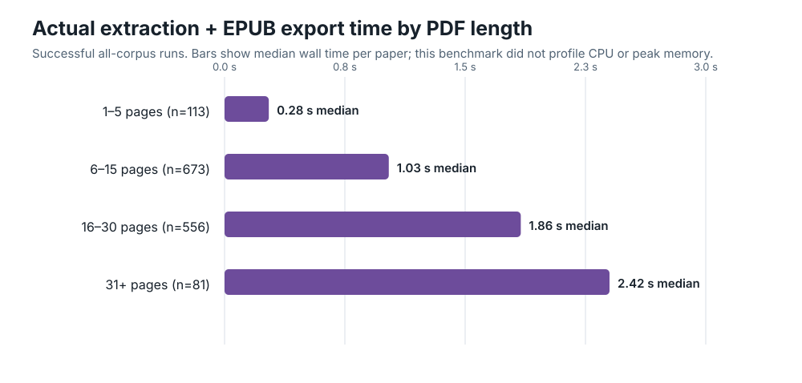

# Versio reliability and performance evaluation

## Executive summary

- **Mobile conversion reliability is measured at scale.** The actual phone-sync format is a single **EPUB 3 file (a ZIP container)**, with no outer per-paper ZIP. On 1,432 de-duplicated PDFs, 1,423 succeeded: **99.37%** (95% Wilson CI 98.8%–99.7%). This is directly comparable to the earlier 1,511-path / 1,432-unique / 1,423-success report because it is that same completed corpus run.
- **The measured phone-sync data size fell by 61.34% overall** (3075.84 MiB source PDF → 1189.10 MiB EPUB); the unweighted mean reduction was 52.71% and median 61.74%. This includes EPUB content and retained visual assets. It is appropriate to say “**実測した1,423本では、スマホ同期用データを総容量で61.34%削減**” with the scope note below. Do not say that this measures Japanese-translation byte size: the run deliberately used original-text fallback to isolate the reflow/assets output.
- **Extraction can be shown as stable, but not as a single end-to-end ‘accuracy’ percentage.** The current seven-paper development gate completed 7/7 and retained source text/provenance at 100%, while the four publisher-disjoint validation candidates passed the label-free health gate 4/4. The independent cohort has no complete human gold yet, so content accuracy (CER, Block F1, reading order, TEDS, formula CDM) is **not measured** there.
- **Current translation is not presentation-safe as an accuracy claim yet.** In the current 12-unit, four-discipline audit, only 6/12 (50.0%) units were fully accepted by the automatic quality gate and 6/12 were reader-visible source fallbacks. A source/output inspection found a material hallucination in an automatically accepted unit; automatic acceptance therefore is not semantic correctness. An independent human reference review and reference translations are still required.

## Scope and reproducibility

| Item | Current evidence | What it establishes | What it does not establish |
| --- | --- | --- | --- |
| Full EPUB run | 2026-11-04T05:34:56.039Z; 1,432 unique PDFs from 1,511 discovered paths | Actual conversion completion, file size, retained exported assets, wall time | Text/structure semantic accuracy, translation quality, CPU/RSS |
| Development extraction gate | 2026-11-05T01:58:45.125Z; 7 existing real-paper fixtures, 240 s/PDF timeout | Regression signal and exact checked fixture dimensions | Independent generalization; complete content accuracy |
| Validation health | 2026-11-05T01:58:58.959Z; 4 publisher-disjoint PDFs, extracted twice | Determinism/integrity/traceability health | Accuracy: it has no complete human gold |
| Current translation audit | 2026-11-05T02:05:58.250Z; 4 papers × 3 sampled units | Production fallback behavior and server-reported translation latency | Corpus-wide rate or semantic correctness |
| Historical translation review | 2026-09-15T06:00:22.720683+00:00; model 3b-mt-v5-semantic-v71-strict-restore-v8 | Prior manually reviewed safety evidence | Current-model quality: model and sample differ |

**Code identity.** The run was made from git rev-parse HEAD = 4e41827087b0f2a211cf3f58d93cecd993d3e37c on main. The worktree was dirty, including extraction-evaluation changes, so every artifact records its input paths and timestamps rather than claiming a clean release build.

## 1. PDF extraction: content, structure, and reliability

### Human-gold metrics versus proxies

The evaluator supports human-authored CER/NED, role-aware Block F1, reading-order edit distance, paragraph-boundary F1, caption-relation F1, table TEDS, and formula NED/CDM. It deliberately emits N/A when the relevant full-page gold is absent. This distinction matters: a parser finishing is not evidence that its text or reading order matches the PDF.

| Evidence | Result | Denominator / qualification |
| --- | --- | --- |
| Development fixture completion | 7/7; 0 timeout/failure | Existing development corpus only; 95% completion CI 64.6%–100.0% |
| Native source integrity | 100.0% | 7/7 documents; integrity invariant, not semantic recall |
| Canonical provenance | 100.0% | 7/7 documents; every Canonical node remains PDF-anchored |
| Heading recall | 86.46% | Macro mean, only 3 annotated development papers |
| Table-caption recall | 75.00% | Macro mean, only 4 annotated development papers |
| Table-region recall | 66.67% | Macro mean, only 3 annotated development papers |
| Reading-order pair score | 100.00% | One annotated development paper only; not generalizable |
| Independent validation health | 4/4 healthy; 0 unhealthy | Label-free double-extraction gate; 95% completion CI 51.0%–100.0% |

The development result also exposes real limitations: table-caption and table-region recall include failures (not silently omitted), and heading hierarchy scored 0 in its sole eligible fixture. The historical 113-paper baseline reports reader-title exactness 93.81% (106/113), but 39 cases use metadata fallback; native PDF-title exactness is only 60.18%. Neither title metric is a proxy for full-text extraction accuracy.

**Unmeasured extraction dimensions.** The publisher-disjoint validation/held-out candidates still lack complete human gold. Therefore independent CER/NED, role-aware Block F1, full reading-order accuracy, paragraph-boundary F1, caption relation F1, TEDS, and CDM are N/A. The required next work is to finish complete page-level gold in Evaluation Studio, export frozen predictions, and run npm run eval:extraction-benchmark; partial annotations must not be converted into 100% scores.

## 2. Translation reliability and quality

### Current model: measured automatic behavior

Current model: google/madlad400-3b-mt on mps, version 3b-mt-v6-transformers-4.57.6-semantic-v84-source-protect-v29-space-footnote-citation-bracket-author-year-tail-restore-strict-restore-v28-quality-v36-relation-condition-beam-v8-section-marker-contextual-number-citation-group-foreign-script-hangul-supplementary-ref-inventory-long-claim-quoted-boundary-repeat-token-dense-citation-claim-compression-beam-v2-identifier-glue-simplified-cjk-rescue-quoted-label-policy.

| Outcome | Result | 95% Wilson CI (descriptive only) |
| --- | ---: | --- |
| Model returned a response | 8/12 | 39.1%–86.2% |
| Fully translated, automatic gate accepted | 6/12 (50.0%) | 25.4%–74.6% |
| Reader-visible original fallback | 6/12 (50.0%) | 25.4%–74.6% |
| Pre-model fallback attributed to extraction/input policy | 3/12 (25.0%) | 8.9%–53.2% |
| Post-model quality/fallback | 3/12 (25.0%) | 8.9%–53.2% |
| Ordinary-body fallback | 3/8 (37.5%) | 13.7%–69.4% |

The paper-level CSV distinguishes pre-model fallbacks (input was already incomplete/unsafe) from post-model fallbacks. In this run, all three medical-review units were stopped before the model because extraction checks found a dropped function word or line-break hyphen/continuation; one HCI unit hit a degenerate server output; two computational-linguistics units were rejected for partial source text/protected-citation restoration. This is the required separation of extraction-induced and model/gate-induced failures, but it is a small stratified audit, not a prevalence estimate.

### Semantics and human review status

No current-model reference translations are available, so COMET, chrF, and BLEU are **not applicable**: applying them without Japanese reference translations would fabricate a score. Automatic invariant, citation, terminology, language and compression checks are logged in the CSV as triage signals only.

An evaluator spot inspection of the 6 automatically accepted outputs found one unequivocal severe semantic failure: interactive-jewellery:b-9481ee91 changes the source discussion of technology-driven wearables into unrelated website/web-application construction. It passed the automatic gate. This inspection is documented as a failure example, **not** claimed as independent human-review statistics.

The only completed broad manual source-to-output review is historical: 139 sampled rows across 21 papers on model 3b-mt-v5-semantic-v71-strict-restore-v8, with 15/65 accepted outputs judged severity ≥2 unsafe (23.08%; descriptive 95% CI 14.5%–34.6%). It also recorded 12/48 (25.00%) ordinary-body fallbacks. This evidence is important negative evidence, but is not comparable to the current model version and must not be used as its accuracy score.

A later partial manual set has 32 reviewed rows and attributes 9 issues to extraction versus 23 to translation. Its own notes say it is not representative; it is retained as a review-calibration artifact only.

**Required to make a quality claim.** Freeze a publisher/layout-stratified current-model sample; commission two independent bilingual reviewers; have them judge meaning, information, negation/comparison/causality/conditions, numbers/units/statistics/citations/terms, hallucination and omission against the rendered PDF; adjudicate disagreements; then report severity ≥2 rate with CI. A parallel run on reviewer-corrected source text is necessary to quantify extraction-caused versus model-caused semantic errors. Until then, no “translation accuracy xx%” claim is supportable.

## 3. Actual conversion performance and mobile size



| Metric | Result |
| --- | ---: |
| Discovered paths / exact duplicates / unique content | 1,511 / 79 / 1,432 |
| Conversion success / failure | 1,423 / 9 |
| Original PDF bytes (successful files) | 3075.84 MiB |
| EPUB ZIP bytes | 1189.10 MiB |
| EPUB uncompressed payload | 1359.73 MiB |
| Total weighted reduction | 61.34% |
| Mean / median per-paper reduction | 52.71% / 61.74% |
| Files not reduced (equal or larger) | 124 |
| Exported asset bytes / asset files | 1263.17 MiB / 10,968 |
| Expected image assets missing from export | 0/10,968 |
| Figure / table / equation blocks observed | 6,744 / 9,434 / 5,821 |

### By document characteristic

| Content profile | Papers | Total-weighted reduction | Mean / median reduction | Equal or larger |
| --- | ---: | ---: | ---: | ---: |
| asset_centered | 1,224 | 59.47% | 47.27% / 54.64% | 117 |
| mixed | 47 | 96.42% | 92.05% / 95.34% | 0 |
| text_centered | 152 | 97.68% | 84.35% / 95.81% | 7 |



| Page count | Successful PDFs | Median wall time | Mean wall time |
| --- | ---: | ---: | ---: |
| 1–5 | 113 | 0.28 s | 0.40 s |
| 6–15 | 673 | 1.03 s | 1.50 s |
| 16–30 | 556 | 1.86 s | 2.58 s |
| 31+ | 81 | 2.42 s | 3.87 s |

Across all successful files, mean/median/p95 wall time was 1.97 / 1.32 / 5.95 seconds (range 0.11–45.87). Page count has a modest Pearson correlation with elapsed time (r = 0.271); file size, asset complexity, and PDF internals also matter. The benchmark records elapsed wall time only. **CPU utilization, RSS/peak memory and per-stage extraction-vs-export timing were not collected, so they are N/A rather than inferred.**

The 9 failures are retained in the JSON/CSV, not excluded: 8 Chromium target crashed; 1 Execution context destroyed during navigation. Their paths and raw errors are in reliability-performance-evaluation-latest.json.

## Presentation-ready wording

Use this sentence, with the note immediately adjacent:

> 実在PDF **1,423本**の全容量測定で、Versioのスマホ同期用EPUBは、原本PDF比で**総容量61.34%削減**（3,075.84 MiB → 1,189.10 MiB、変換成功率99.37%）でした。

Note: “2026-11-04 measurement; 1,511 discovered local paths, 79 content duplicates removed, 1,432 unique PDFs measured. Actual EPUB 3/ZIP output with current image optimization and all exported visual assets; original-text fallback was used, so the figure does not measure Japanese translation text size. Nine conversion failures are included in the success rate.”

Do **not** use “PDF extraction accuracy xx%” or “translation accuracy xx%” in the presentation yet. The defensible adjacent claim is: “Independent human-gold evaluation of full content/structure and current Japanese semantic fidelity is in progress; current tests measure stability and explicitly preserve/reveal fallback.”

## Reproduction

```sh
# Code identity and dirty-tree state
git rev-parse HEAD
git status --short

# Existing fixture first: human-gold evaluator logic + extraction regressions
npm test -- --run src/test/evaluation/benchmarkEvaluate.test.ts src/test/evaluation/reviewGold.test.ts src/test/evaluation/standardMetrics.test.ts
npm run bench:pdf-extraction:development -- --timeout-ms 240000 --output test-data/extraction-evaluation/current-development-regression.json
npm run audit:pdf-extraction:unlabeled -- --cohort test-fixtures/extraction-benchmark/validation-cohort-v1.json --all --timeout-ms 240000 --output test-data/extraction-evaluation/current-validation-health.json

# Explicit four-paper current-model sample (the runner checkpoints each paper)
./restart-translation-server.sh
MADLAD_BENCH_CONCURRENCY=2 npm run bench:real-paper-translation -- \
  --papers interactive-jewellery,medical-deep-learning-meta-review,marketing-consumer-response,computational-linguistics-nlp-translation \
  --limit 3 --report-name translation-audit-current-v6-stratified-v1

# The all-PDF EPUB run is explicit and resumable; only run it when a new full measurement is needed.
npm run bench:mobile-epub-storage

# Recreate this report, CSV/JSON and SVG figures without rerunning models.
npm run report:reliability-performance-evaluation
```

The all-PDF runner records progress and per-paper elapsed time; its existing completed report is reused here instead of silently running a new 1,432-PDF job. The translation runner checkpoints after each paper and has request timeouts. A future all-113 translation run must use its explicit --full-corpus --resume mode and should add a run-level wall-clock/CPU/RSS recorder before it is used for performance claims.

## Deliverables

- [Machine-readable summary and full row results](../test-data/real-papers/reports/reliability-performance-evaluation-latest.json)
- [Paper/block-level CSV](../test-data/real-papers/reports/reliability-performance-evaluation-latest.csv)
- [EPUB capacity graph](./evaluation-figures/reliability-epub-summary.svg)
- [Processing-time graph](./evaluation-figures/reliability-processing-time.svg)
- [Current translation outcome graph](./evaluation-figures/reliability-translation-outcomes.svg)
